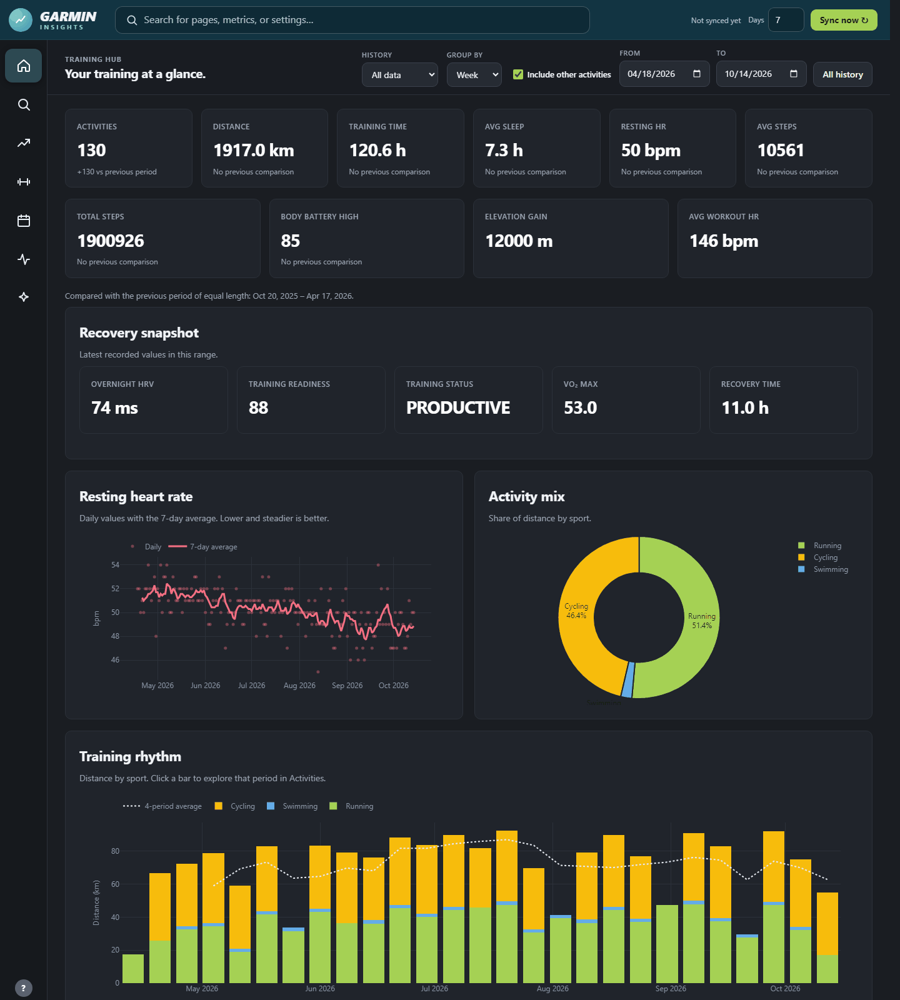
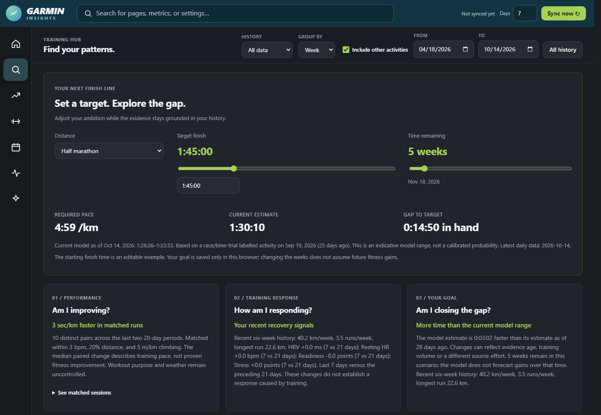
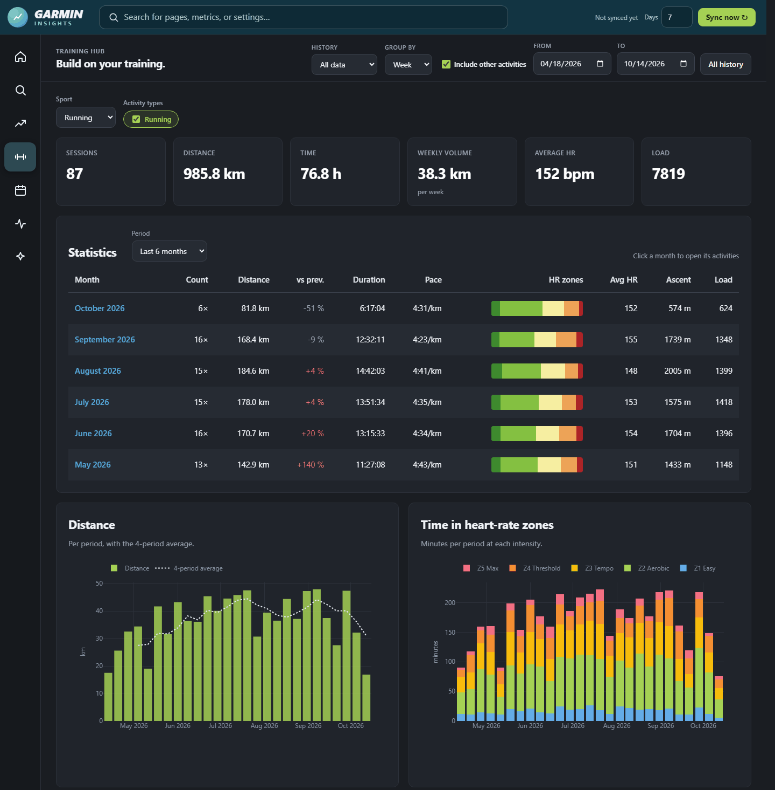
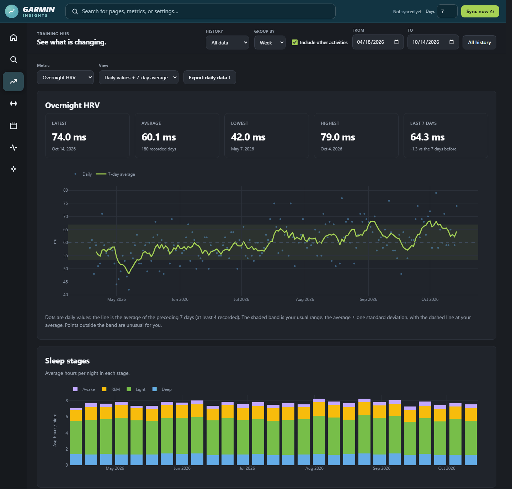
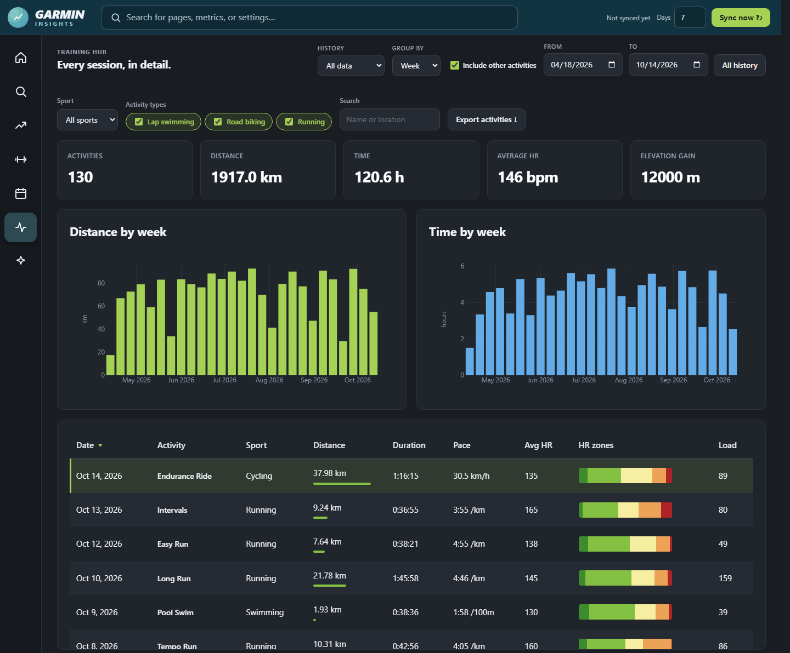

# Garmin Insights

A local dashboard for your Garmin Connect data. It syncs activities, sleep and
daily stats into a SQLite database on your machine, then shows trends, training
load, a training calendar, race predictions, and optional AI coaching insights.

Your data stays local. Network requests are made only when you sync with Garmin
Connect or explicitly ask for an AI insight.

## Features

- **Overview, Trends, Training, Activities** – charts and tables built from your synced history, including per-activity splits
- **Discoveries** – exploratory comparisons of running efficiency, sleep and recovery
- **Calendar** – planned vs. completed training with manual adherence corrections
- **Race prediction** – Garmin's predictions alongside an independent model calibrated on your race efforts
- **AI insights** – summaries and chat through the Claude Code or Codex CLI, using your existing subscription (optional)
- **Auto-sync** – background refresh while the server is running
- **Claude tools (MCP)** – Claude Desktop and claude.ai can read your history and live Garmin data
- **AI endurance coach** – on a self-hosted server, Claude plans a season, validates each week
  against coaching rules and puts the workouts on your Garmin calendar so they sync to the watch
- **Companion Android app** – a separate, private app that signs in to the hosted server and shows
  and moves the coach's planned workouts (it uses `/api/plan`, `/api/plan/move` and `/api/review`)

## Screenshots

*Shown with synthetic demo data.*



<table>
  <tr>
    <td></td>
    <td></td>
  </tr>
  <tr>
    <td></td>
    <td></td>
  </tr>
</table>

## Requirements

Python 3.10+ and a Garmin Connect account run the core. Everything else is optional and stays
off until you set it up:

| Feature | What you need |
| --- | --- |
| Dashboard, sync, calendar, race prediction | A Garmin Connect account |
| AI insights and chat | [Claude Code](https://docs.claude.com/en/docs/claude-code) or the [Codex CLI](https://github.com/openai/codex), installed and signed in (`claude` then `/login`, or `codex login`) |
| Claude Desktop tools (read-only) | Claude Desktop ([setup](#claude-desktop-mcp)) |
| Live `garmin_*` tools | A Garmin Personal API key |
| Strength workouts | [Hevy](https://www.hevyapp.com/) Pro and its API key |
| AI coach that writes workouts to Garmin, coaching history, the Android app | Your own server and domain, see [deploy/README.md](deploy/README.md) |

## Setup

```bash
git clone https://github.com/mik91/Garmin-api.git
cd Garmin-api
python -m venv .venv
```

Activate the environment (`.\.venv\Scripts\Activate.ps1` on Windows,
`source .venv/bin/activate` on macOS/Linux), then install dependencies:

```bash
pip install -r requirements.txt
```

Start the web interface and open http://127.0.0.1:8502:

```bash
python -m garmin_ai.web_server
```

## Connecting accounts

Open **Connections** in the sidebar. Everything can be set up there; no `.env` is needed.

- **Garmin Connect** – sign in with your email and password, plus the MFA code if Garmin
  asks for one. Only the resulting sign-in token is stored (in `.garmin_tokens/`); your
  password is never saved. Then press **Sync now** to pull in your history.
- **AI coach** – choose Claude Code or Codex. The page shows whether each CLI is installed
  and signed in, and **Sign in** opens the CLI's own browser sign-in. **Test connection**
  sends a short message to check it works.
- **Auto-sync** – how often to refresh in the background and how many days to fetch.
- **Hevy** (optional, Hevy Pro) – set `HEVY_API_KEY` in `.env` and each sync also pulls your
  lifting workouts, linked to the matching Garmin strength activity for heart rate. They are
  served read-only at `/api/strength` and per exercise at `/api/strength/exercise`
  ([response shapes](docs/strength-api.md)).

AI requests run the CLI on your machine, so they count against your Claude or ChatGPT
subscription rather than a paid API key. Any `ANTHROPIC_API_KEY`/`OPENAI_API_KEY` in the
environment is hidden from the CLI so it never bills an API account by accident.

Settings saved on this page go to `data/settings.json` and take precedence over `.env`.
You can still configure everything through `.env` instead (see `.env.example` for all
options, including the database path and web port); never commit it.

Syncing from a terminal also works, and prompts for an MFA code if needed:

```bash
python cli.py sync --days 90
```

To sync in the background even when the web app is closed (Windows), register a scheduled
task that runs at sign-in and every 2 hours and logs to `data/sync.log`:

```powershell
.\scripts\schedule-sync.ps1            # -Days 7 -EveryHours 2 by default
.\scripts\schedule-sync.ps1 -Remove
```

If Garmin ever asks for an MFA code again, the log shows a failure; sign in once from the
Connections page and the task picks up again.

On Windows you can also run `.\start.ps1`. The older Streamlit dashboard is still
available with `streamlit run app.py` (or `.\start.ps1 -Legacy`) on port 8501.

## Claude Desktop (MCP)

`garmin_ai/mcp_server.py` lets Claude Desktop chats read your Garmin data, with two kinds of tools:

- **Live, from Garmin's official Personal API** (`garmin_activities`, `garmin_activity`,
  `garmin_activity_workout`, `garmin_daily_summaries`, `garmin_sleep`, `garmin_sleep_summaries`,
  `garmin_hrv`, `garmin_body_battery`, `garmin_stress`, `garmin_heart_rate`,
  `garmin_heart_rate_zones`, `garmin_spo2`, `garmin_weight`, `garmin_fitness_age`). Create a key
  in Garmin Connect (account settings > Personal API; it is shown once) and put it in `.env` as
  `GARMIN_PERSONAL_API_KEY`, or save it to `~/.config/garmin/connect-personal-api-key`.
- **From the local synced history** (`sync_status`, `coaching_summary`, `list_activities`,
  `get_activity`, `daily_metrics`, `weekly_load_summary`, `race_predictions`, `training_calendar`, `strength_workouts`
  and `exercise_progress` (Hevy), and read-only SQL via
  `query_database`). These include metrics the official API does not provide: training readiness
  and status, VO2 max, recovery time, race predictions and the training calendar. `data/garmin.db`
  is opened read-only; keep it fresh with auto-sync or `python cli.py sync`.

On Windows, quit Claude Desktop (tray icon > Quit) and run
`.\scripts\install-claude-desktop-mcp.ps1`; Claude Desktop rewrites its config while running,
so edits made with it open are lost. Or add this to `claude_desktop_config.json` yourself while
the app is closed, using the Python that has this project's requirements installed:

```json
{
  "mcpServers": {
    "garmin": {
      "command": "C:\\path\\to\\Garmin-api\\.venv\\Scripts\\python.exe",
      "args": ["-m", "garmin_ai.mcp_server"],
      "env": {"PYTHONPATH": "C:\\path\\to\\Garmin-api"}
    }
  }
}
```

## AI coach: workout tools (remote connector only)

The hosted server's `/mcp` (see [deploy/README.md](deploy/README.md)) also lets Claude create
structured workouts and put them on your Garmin Connect calendar, so they sync to the watch.
The local Claude Desktop server stays read-only, so there is a single record of what the coach
created. To write from Claude Desktop, use the remote connector there too.

Every workout the tools create is named `[CP] …` and recorded in `coach_workouts` /
`coach_schedules` in `garmin.db`. Workouts that are not both recorded and still named `[CP] `
on Garmin (Runna, Garmin Coach, your own) are never updated, unscheduled or deleted. Each upload
is read back from Garmin and any difference is returned as an error. The tools use the sync's
Garmin sign-in token; there are no extra credentials.

| Tool | What it does |
| --- | --- |
| `create_workout(sport, name, steps, description?, pool_length_m?, date?, dry_run=false)` | Build and upload one workout, optionally scheduling it. `sport`: `running`, `cycling`, `lap_swimming`, `strength`. |
| `schedule_workout(workout_id, date)` | Put a `[CP]` workout on the calendar (YYYY-MM-DD). |
| `upload_plan(items, dry_run=false, allow_errors=false)` | `items: [{date, workout: {sport, name, steps, …}, session?}]`. Creates and schedules a block in one call. It is safe to repeat: the same date + name is skipped when unchanged and updated when changed. Every week is checked with the coaching rules (see below); errors block the upload unless `allow_errors=true`. |
| `list_planned_workouts(start?, end?)` | Only `[CP]` workouts, with summary and completion status. |
| `update_workout(workout_id, sport?, name?, steps?, description?, pool_length_m?, dry_run=false)` | Change a `[CP]` workout. `steps`, when given, replaces all steps. |
| `unschedule_workout(date? \| schedule_id?)` | Remove `[CP]` workouts from the calendar. Other workouts that day stay. |
| `delete_workout(workout_id)` | Delete a `[CP]` workout and its calendar entries. |
| `weekly_load_summary(weeks=12)` | Per Monday–Sunday week: running km, runs, longest run, hours and sessions per sport (Hevy gym sessions count as strength), quality sessions (Garmin training-effect label tempo, threshold, VO2 max, anaerobic or speed), HR zone 4–5 minutes and training load. It also gives 12-week averages and the last 4 weeks compared with the 4 before. Read-only, also available locally. |
| `training_paces(race_distance_m?, race_time?)` | Daniels-style (VDOT) easy, marathon, threshold, interval and repetition paces from the 5K prediction or a given race. Read-only, also available locally. |

Step schema (metric units):

```json
{"type": "warmup | interval | recovery | rest | cooldown | repeat",
 "duration": {"time_s": 600} | {"distance_m": 1000} | {"lap_button": true} | {"reps": 12},
 "target": {"pace_min_per_km": ["4:50", "5:05"]} | {"hr_zone": 2} | {"hr_bpm": [135, 150]}
           | {"power_w": [180, 210]} | {"cadence": [85, 95]} | "none",
 "repeat": {"count": 4, "steps": [], "skip_last_rest": false},
 "swim": {"stroke": "free", "drill": "kick", "equipment": "kickboard"},
 "notes": "shown on the watch"}
```

- Pace targets are for running only. Power targets are for cycling only (absolute watts). `reps` is for strength only.
- Swim distances must be whole pool lengths (`pool_length_m` defaults to 25). Swim rest is fixed time or lap button.
- Repeats cannot be nested, and rest steps have no target.
- Strength steps carry the exercise in `notes`.

`upload_plan` runs the same validator as `validate_week_plan` on each week it touches, together
with the `[CP]` workouts already scheduled that week. Minutes, run km and intensity are estimated
from the steps: hard means HR zone 4+ or near threshold pace, the long run is the run named "long"
(else the longest easy run of 60+ minutes), and names with race / time trial / all-out count as
all-out (set `session.all_out` for a CSS or 5K test). Swim distance steps use 2:00/100 m
(`swim.default_pace_s_per_100m`); steps without a duration fall back to "40min" in the name. The optional `session` (`slot`, `kind`, `intensity`, `all_out`, `hard_minutes`, `km`,
`minutes`) corrects the estimate. For a block of several weeks, each week's ramp is checked
against the planned week before it. It also warns about easy steps paced faster than marathon pace.

### Coaching guardrails and history

The coach follows [docs/coaching-method.md](docs/coaching-method.md) (plan, validate, dry-run,
upload, log); a short version is sent to MCP clients as the server instructions. Thresholds are
in `garmin_ai/coaching/rules.json`. The history lives in
`coach_log` and `coach_profile` in the server's `garmin.db`, so it stays with the hosted connector.

| Tool | What it does |
| --- | --- |
| `check_readiness(as_of?, reported?)` | Green / yellow / red / unknown from HRV, resting HR, sleep and training readiness, plus the actions to apply. `reported: ["sick"]` (or pain, injury) forces red. Read-only, also available locally. |
| `season_plan(weeks?, start?)` / `start_season_plan(peak_run_km?, start_long_swim_m?, dry_run=true)` | The season to the next A race, generated in code (`garmin_ai/coaching/season.py`): phase, lighter weeks, run km and long run, quality sessions from fixed progressions (threshold, VO2, race pace, sharpening), hills and strides, swim targets and the flexible slot. Anchors are saved once in the profile; each week's target is capped by what was run the week before, and `upload_plan` compares the week with it. |
| `swim_trend(weeks=12)` / `swim_paces()` / `record_css_test(t400, t200, date?, note?)` | Swim pace per 100 m, SWOLF and longest swim per week; CSS from the 400 m + 200 m test with zones, kept as a history. The season plan's swim sets use the latest CSS. |
| `easy_pace_trend(weeks=12, hr_low?, hr_high?)` → `corrected` | Easy-run efficiency corrected for speed, hills, warm-up and heat: pace at a reference HR per 3-week window with a margin of error. The sync fetches per-km laps and Garmin's per-activity weather (20 activities per sync, newest first, then older ones). |
| `season_progress()` | Is the plan working: run km vs season targets (4 weeks), sessions completed, VDOT vs the line to the goal, checkpoint time trials (expected vs found in the synced runs), easy pace, swim trend, CSS age, readiness; flags (ok / watch / act) and a verdict. |
| `week_review(week_start?)` | Planned vs done for one week (default last week): calendar sessions completed / missed, the `[CP]` plan's km and quality vs actual, readiness at start and end, the week's log, and a suggested `actual` line for the log. |
| `easy_pace_trend(weeks=12, hr_low?, hr_high?)` | Easy-run pace inside one HR band per week; faster at the same HR = fitter. Read-only, also available locally. |
| `readiness_calibration(weeks=16)` | Readiness before each past week vs sessions completed and missed, by status, to tune the thresholds. Read-only, also available locally. |
| `validate_week_plan(plan, history_override?)` | Checks a drafted week (ramp, lighter week, quality count and spacing, races 4+ weeks apart, 80/20, long run, midday swims, easy-run targets, sessions per sport). History is filled from synced activities. Read-only, also available locally. |
| `log_coaching_decision(summary, kind?, week_start?, readiness?, planned?, actual?, details?)` | Append to the decision log (`plan`, `adjustment`, `review`, `note`). Real `upload_plan` calls are logged automatically. |
| `coaching_history(start?, end?, kind?, limit=30)` | The log, newest first. |
| `athlete_profile()` / `update_athlete_profile(section, content, reason?)` | Races (JSON list with priority A/B/C), fitness anchors, constraints, cautions and `rule_overrides` (JSON merged into the rules). Returns the season phase (base, build, peak, taper, race week, recovery) from the next A race. Every edit keeps the old text in the log. |

`training_calendar` marks the coach's workouts with `created_by_coach`. After changing this
code, redeploy the server (deploy/README.md), then reconnect the connector in claude.ai if the
new tools do not appear.

### Weekly review (automatic)

Every Sunday evening the web server reviews the week on its own, in code, with no AI model,
so the result is the same whichever chat model you coach with:

1. it syncs first (or waits for the sync already running), then
2. stores one `coach_log` entry of kind `review` for the week (Monday to Sunday) with
   `season_progress` (verdict on track / watch / act and flags), `week_review` (planned vs done,
   readiness at the start and end) and next week's season target, capped by this week's run km.
   `actual` holds the week's one-line summary, `planned` next week's target, `details` the full
   payload.

It runs inside the server (a background thread next to the auto-sync), so it ships with the
Docker image; no host cron. If the server was down at the time, it catches up when it starts.
Re-running for the same week replaces the automatic entry and never touches reviews the coach
logged with `log_coaching_decision`.

| Setting | Default | |
| --- | --- | --- |
| `GARMIN_WEEKLY_REVIEW` | `sun 19:00` | Weekday and 24 h time, or `off`. |
| `GARMIN_TIMEZONE` | server local time | IANA zone for that time, e.g. `America/Toronto` (the container runs in UTC). |

The app shows it as the **This week** card at the top of the Overview: verdict in colour, the
flags (act first), done vs planned (runs, run km, swims, completion), readiness at the start and
end of the week, and next week's target (run km, long run, quality sessions, swims).

- `GET /api/review` returns the latest review (`{"review": null}` before the first one);
  `?week=YYYY-MM-DD` picks the week containing that day. Read-only, so the app's OAuth token
  can read it like `/api/plan`.
- `/api/plan` and `/api/dashboard` include the card as `weekly_review`.
- `coaching_history` shows automatic reviews with their card only, to keep the coach's context small.

## Project layout

```text
garmin_ai/      sync, database, analysis, race prediction, AI and web server code
web/dist/       static HTML/CSS/JS frontend served by the local server
app.py          legacy Streamlit dashboard
cli.py          command-line sync
tests/          unit tests (run with: python -m pytest)
```

Generated at runtime and ignored by git: `.garmin_tokens/` (Garmin session) and
`data/garmin.db` (your synced data).

## Security

By default the web server binds to `127.0.0.1` only, serves an explicit allowlist of static
files, and rejects cross-origin API requests. Do not expose that local mode to the internet.

Hosted mode (`GARMIN_HOSTED=true`, see [deploy/README.md](deploy/README.md)) is the only setup
meant to face the internet: it runs behind HTTPS, requires a password sign-in for the dashboard
and OAuth for `/mcp` and the app, and stores sessions and tokens only as hashes.

## Disclaimer

This project is not affiliated with or endorsed by Garmin. It uses the unofficial
[`garminconnect`](https://github.com/cyberjunky/python-garminconnect) library.
Insights and predictions are exploratory and are not medical or coaching advice.

## License

[MIT](LICENSE)
