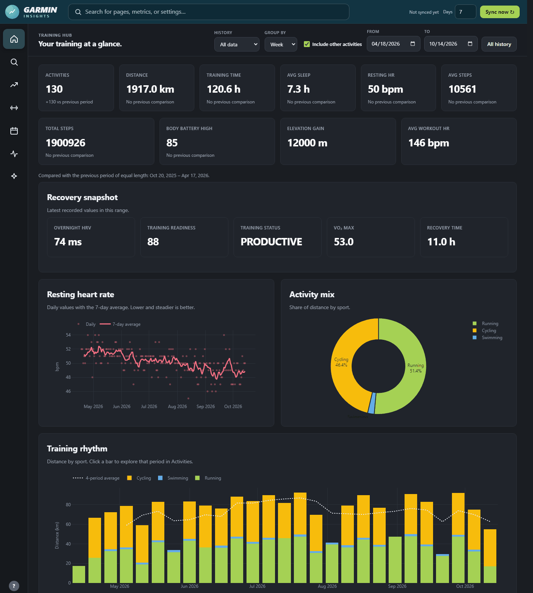
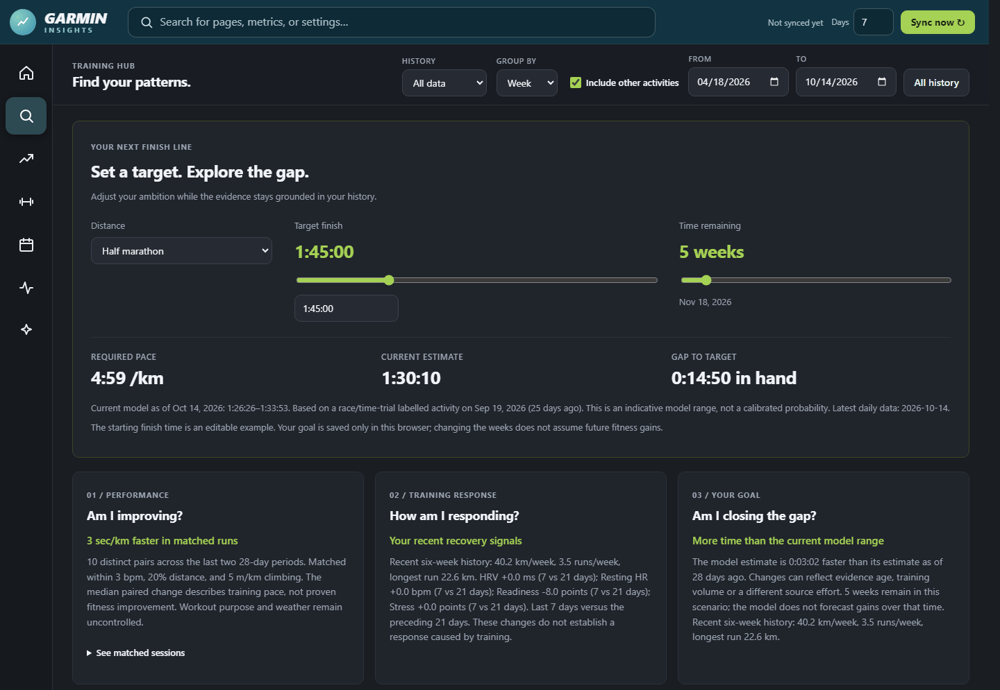
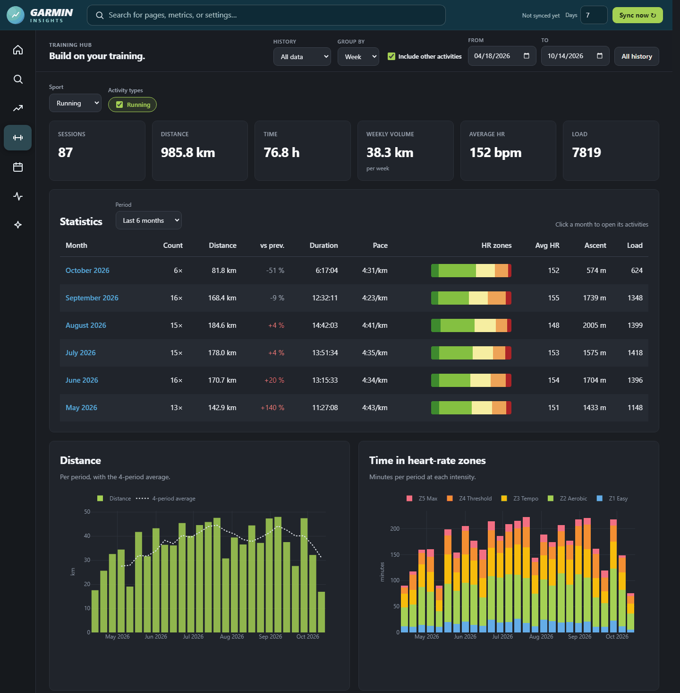
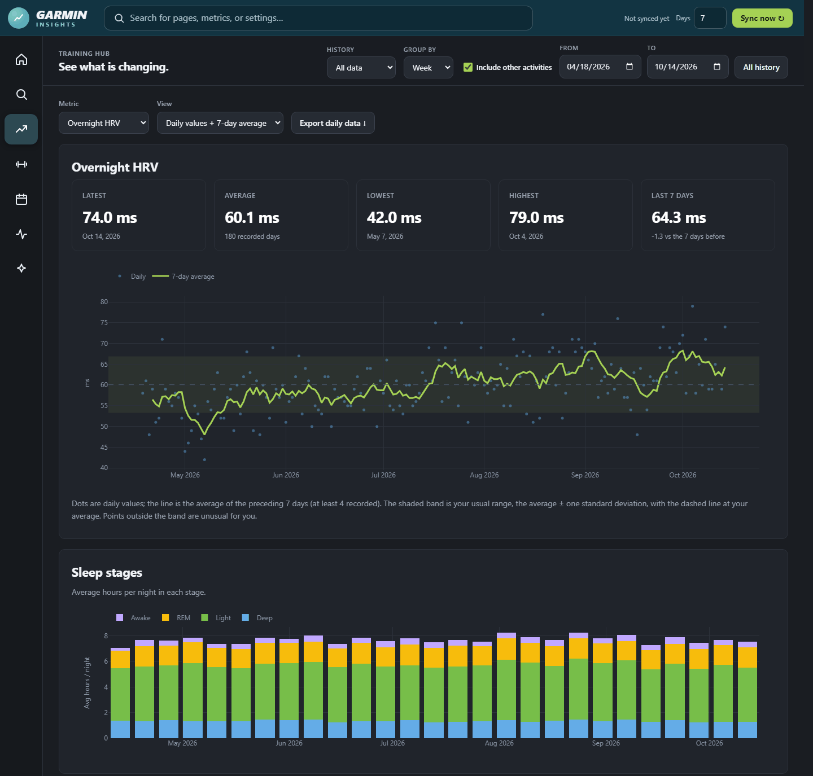
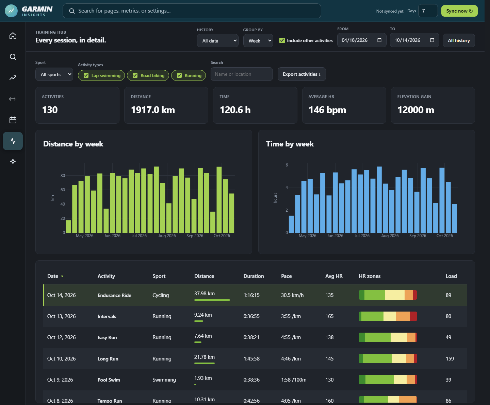

# Garmin Insights

A local dashboard for your Garmin Connect data. It syncs activities, sleep and
daily stats into a SQLite database on your machine, then shows trends, training
load, a training calendar, race predictions, and optional AI coaching insights.

Your data stays local. Network requests are made only when you sync with Garmin
Connect or explicitly ask for an AI insight.

## Features

- **Overview, Trends, Training, Activities** – charts and tables built from your synced history, including per-activity splits
- **Discoveries** – exploratory comparisons of running efficiency, sleep and recovery
- **Calendar** – planned vs. completed training with manual adherence corrections
- **Race prediction** – Garmin's predictions alongside an independent model calibrated on your race efforts
- **AI insights** – summaries and chat through the Claude Code or Codex CLI, using your existing subscription (optional)
- **Auto-sync** – background refresh while the server is running

## Screenshots

*Shown with synthetic demo data.*



<table>
  <tr>
    <td></td>
    <td></td>
  </tr>
  <tr>
    <td></td>
    <td></td>
  </tr>
</table>

## Requirements

- Python 3.10+
- A Garmin Connect account
- Optional, for AI insights: [Claude Code](https://docs.claude.com/en/docs/claude-code) or the
  [Codex CLI](https://github.com/openai/codex), installed and signed in (`claude` then `/login`, or `codex login`)

## Setup

```bash
git clone https://github.com/mik91/Garmin-api.git
cd Garmin-api
python -m venv .venv
```

Activate the environment (`.\.venv\Scripts\Activate.ps1` on Windows,
`source .venv/bin/activate` on macOS/Linux), then install dependencies:

```bash
pip install -r requirements.txt
```

Start the web interface and open http://127.0.0.1:8502:

```bash
python -m garmin_ai.web_server
```

## Connecting accounts

Open **Connections** in the sidebar. Everything can be set up there; no `.env` is needed.

- **Garmin Connect** – sign in with your email and password, plus the MFA code if Garmin
  asks for one. Only the resulting sign-in token is stored (in `.garmin_tokens/`); your
  password is never saved. Then press **Sync now** to pull in your history.
- **AI coach** – choose Claude Code or Codex. The page shows whether each CLI is installed
  and signed in, and **Sign in** opens the CLI's own browser sign-in. **Test connection**
  sends a short message to check it works.
- **Auto-sync** – how often to refresh in the background and how many days to fetch.

AI requests run the CLI on your machine, so they count against your Claude or ChatGPT
subscription rather than a paid API key. Any `ANTHROPIC_API_KEY`/`OPENAI_API_KEY` in the
environment is hidden from the CLI so it never bills an API account by accident.

Settings saved on this page go to `data/settings.json` and take precedence over `.env`.
You can still configure everything through `.env` instead (see `.env.example` for all
options, including the database path and web port); never commit it.

Syncing from a terminal also works, and prompts for an MFA code if needed:

```bash
python cli.py sync --days 90
```

On Windows you can also run `.\start.ps1`. The older Streamlit dashboard is still
available with `streamlit run app.py` (or `.\start.ps1 -Legacy`) on port 8501.

## Project layout

```text
garmin_ai/      sync, database, analysis, race prediction, AI and web server code
web/dist/       static HTML/CSS/JS frontend served by the local server
app.py          legacy Streamlit dashboard
cli.py          command-line sync
tests/          unit tests (run with: python -m pytest)
```

Generated at runtime and ignored by git: `.garmin_tokens/` (Garmin session) and
`data/garmin.db` (your synced data).

## Security

The web server binds to `127.0.0.1` only, serves an explicit allowlist of static
files, and rejects cross-origin API requests. It is meant for personal local use;
do not expose it to the internet.

## Disclaimer

This project is not affiliated with or endorsed by Garmin. It uses the unofficial
[`garminconnect`](https://github.com/cyberjunky/python-garminconnect) library.
Insights and predictions are exploratory and are not medical or coaching advice.

## License

[MIT](LICENSE)
